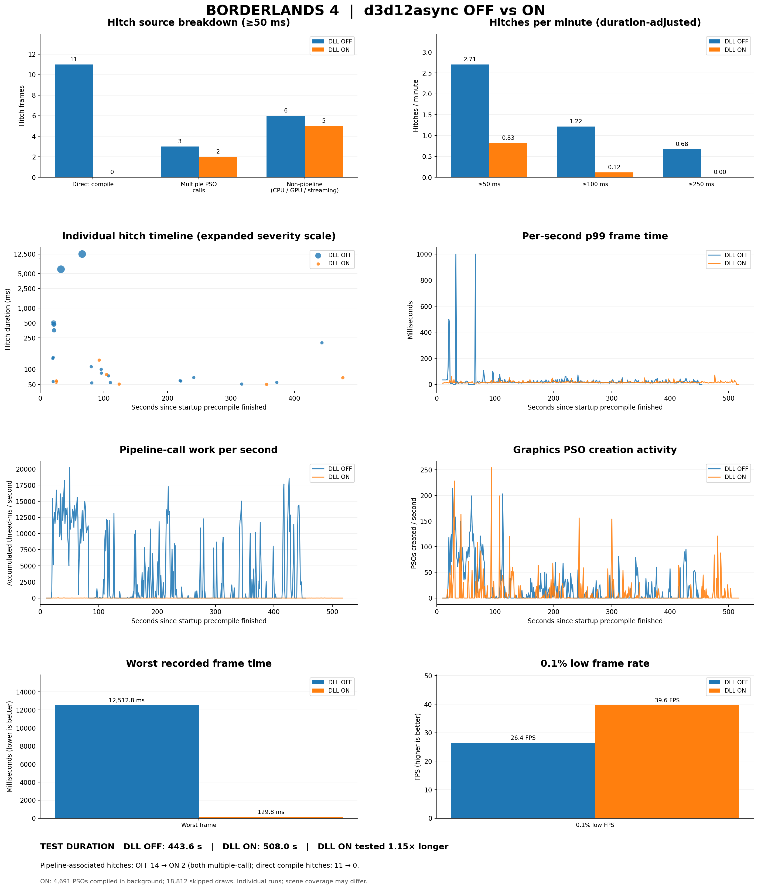
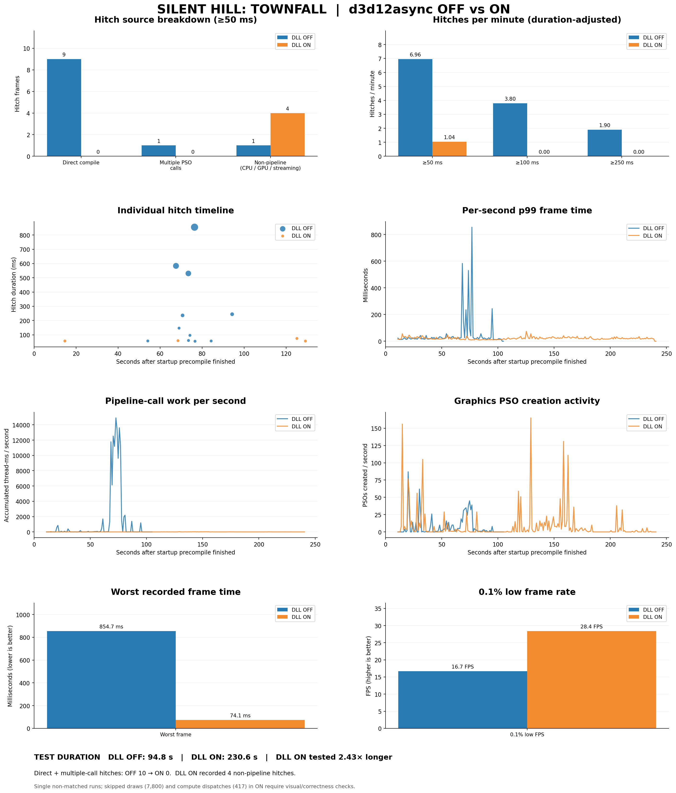
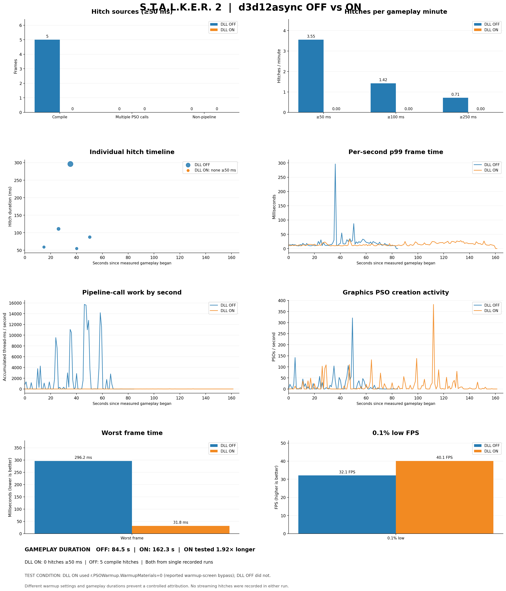
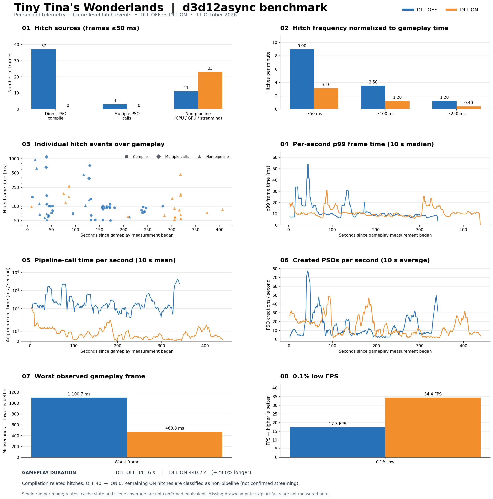
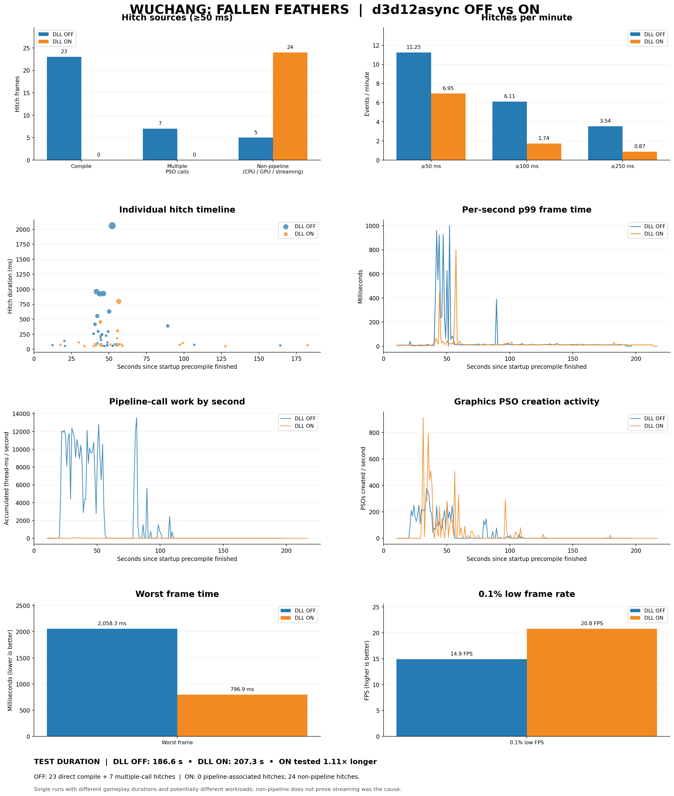
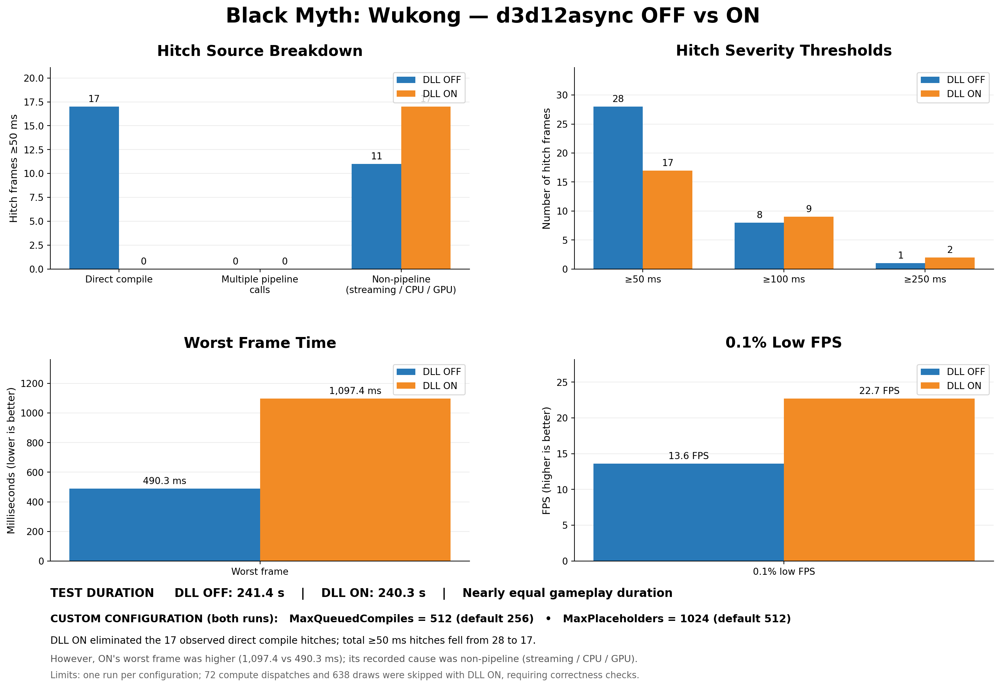
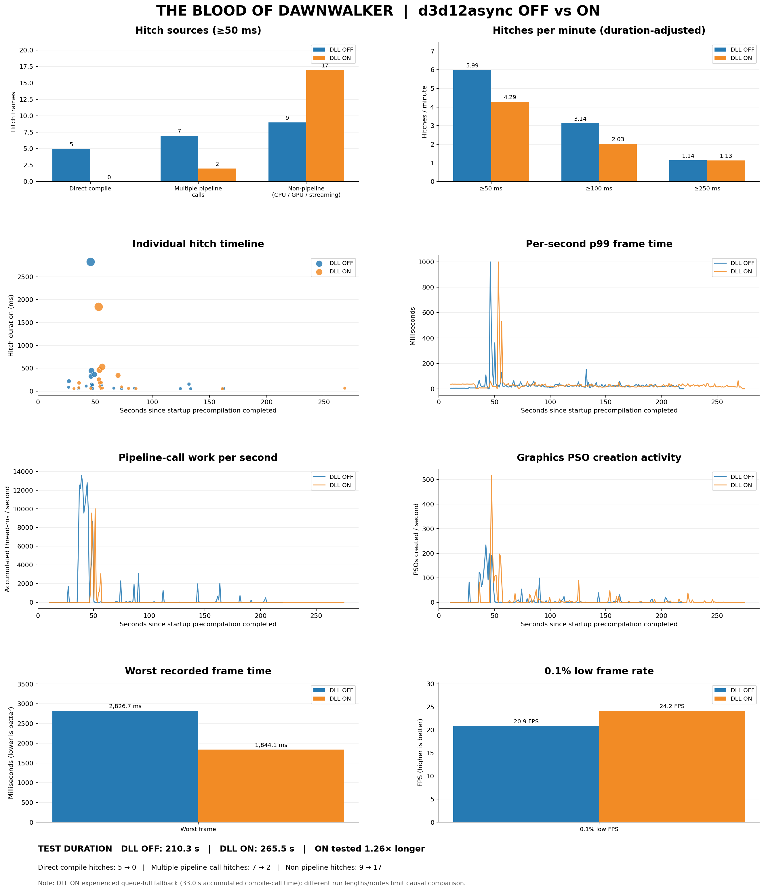
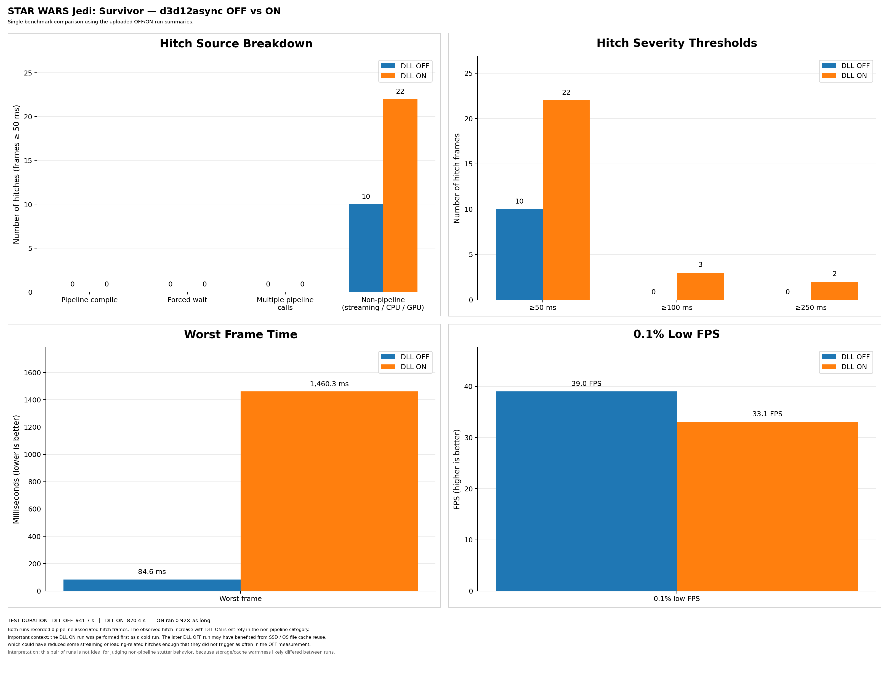

# USPF — Unreal shader proxy fix

**GitHub:** https://github.com/RedMatterGG/USPF-Unreal-shader-proxy-fix

Important notes: 
Some functionalities explained here for the app and not fully implemented but the proxy dll is fully complete and functional.

The startup precompile step (`StartupCompileNormally`) is back on by default since 0.3.1. While the game compiles its shaders at launch, the DLL lets it compile normally, so main menu items are no longer missing on a first launch. On a second launch, when the GPU driver already has the game's shaders cached, the DLL now notices that the startup pipelines are cache hits and switches to background compiling right away (`StartupWarmLaunch`), instead of waiting several minutes as before. On a first launch it waits at least 40 seconds (`StartupMinSeconds`, was 150). If a game still misbehaves, turn `StartupCompileNormally` off in Settings and save; restarting the game also fixes a broken menu. Games installed with an older version keep their old `d3d12async.ini`: click **Reset to defaults** in Settings to get the new values.

Its very likely this also works in other game engines or at least some parts of it but i have not tested it.

USPF removes shader-compilation stutter in DirectX 12 Unreal Engine games.

When a DX12 Unreal game meets a material it hasn't compiled yet, it compiles the pipeline
on the spot and the frame freezes until it's done, often for 100 ms to several seconds. USPF
installs a small `d3d12.dll` layer (d3d12async) next to the game: pipeline compiles go to
background threads, and the game keeps rendering while they finish. A draw whose pipeline
isn't ready yet is skipped for a frame or two instead of freezing the whole frame.

The game's own files are not modified. The DLL sits next to the game's exe and can be removed
at any time from the app.

**Single-player / offline games only.** USPF refuses games with anti-cheat unless you
confirm, and doesn't bypass anti-cheat, DRM or integrity checks.

## Results

Each pair is one run with the layer off (`Enabled=0`, the DLL only measures) and one with it
on, logged by the DLL's own run logs. The runs differ in length and route, so treat them as
examples, not benchmarks. "Shader hitches" are frames of 50 ms or more caused by pipeline work;
the other hitches come from streaming, CPU or GPU load, which USPF doesn't change.

| Game | Shader hitches (off → on) | All hitches ≥ 50 ms | 0.1% low fps | Worst frame |
|---|---|---|---|---|
| Borderlands 4 | 14 → 2 | 20 → 7 | 26.4 → 39.6 | 12,513 ms → 130 ms |
| Silent Hill: Townfall | 10 → 0 | 11 → 4 | 16.7 → 28.4 | 855 ms → 74 ms |
| S.T.A.L.K.E.R. 2 | 5 → 0 | 5 → 0 | 32.1 → 40.1 | 296 ms → 32 ms |
| Tiny Tina's Wonderlands | 40 → 0 | 51 → 23 | 17.3 → 34.4 | 1,101 ms → 469 ms |
| Wuchang: Fallen Feathers | 30 → 0 | 35 → 24 | 14.9 → 20.8 | 2,058 ms → 797 ms |
| Black Myth: Wukong | 17 → 0 | 28 → 17 | 13.6 → 22.7 | 490 ms → 1,097 ms |
| The Blood of Dawnwalker | 12 → 2 | 21 → 19 | 20.9 → 24.2 | 2,827 ms → 1,844 ms |
| Star Wars Jedi: Survivor | 0 → 0 | 10 → 22 | 39.0 → 33.1 | 85 ms → 1,460 ms |

The worst frames that got worse (Wukong, Jedi: Survivor) were not shader compiles: they were
streaming hitches. In the Jedi: Survivor pair the ON run was played first, with cold disk caches,
and the game's shader cache was already warm, so there were no shader hitches to remove.

<b>Borderlands 4</b>

<b>Silent Hill: Townfall</b>

<b>S.T.A.L.K.E.R. 2</b>

<b>Tiny Tina's Wonderlands</b>

<b>Wuchang: Fallen Feathers</b>

<b>Black Myth: Wukong</b>

<b>The Blood of Dawnwalker</b>

<b>Star Wars Jedi: Survivor</b>

## Getting started

1. Download `USPF.exe` from the releases page and run it. It's a single file: the DLL, its
   default settings and the UI are inside it.
2. Pick the game in the top bar. Installed Unreal games are found automatically.
3. Click **Install** on the Dashboard, then start the game.
4. Play a while, then open **Performance** to see the run: frame rate, frame times and every
   hitch with its cause.

To compare, turn the layer off on the Dashboard (the DLL then only measures), play the same
part again, and look at both runs in Performance.

Needs Windows 10 or 11 with the Microsoft Edge WebView2 Runtime (Windows 11 already has it).

## The app

- **Dashboard**
  - The selected game's banner and its last run: average fps, 1% and 0.1% lows, max fps,
    shader hitches.
  - Install, reinstall or uninstall the DLL, and turn the layer on or off.
  - Optional Unreal PSO precache settings in the game's `Engine.ini` (Full or Fast).
  - Clear the game's own shader caches or the GPU driver caches (type YES to confirm).
  - Shortcuts to the game, run-log, install and Saved folders.
- **Performance**: pick a run and see
  - frame rate per second (average, 1% low, 0.1% low) and the time of every frame;
  - the hitch table with each hitch's cause (click a row to zoom the charts to it);
  - the run summary, and a chart and table of every run of that game.
- **Settings**: the game's `d3d12async.ini`. Basic shows the options that matter most;
  Advanced shows every key. Hover `?` for each option's explanation. Reset to defaults writes
  the bundled defaults.
- **About**: version, update check and a link to the GitHub page.

### Finding games

The game selector lists Unreal games from:
- Steam, including libraries Steam itself doesn't list (any `steamapps` folder with
  `appmanifest_*.acf` files), Epic and GOG;
- game folders on every drive: `Games`, `SteamLibrary\steamapps\common`, `steamapps\common`,
  `Epic Games`, `GOG Games` and the store folders under Program Files, plus folders you add
  under **Game folders…**;
- games added by hand (any exe; a launcher resolves to the real Unreal game exe).

The game exe is the `*-Shipping.exe`, or for games that ship a renamed one (Borderlands 4,
Jedi: Survivor), the largest non-helper exe in `<Project>\Binaries\Win64`. Saved and config
folders are matched by the Unreal project name, the install folder, the exe and its product
name. Banners come from Steam, otherwise from the exe's icon.

## What goes where

- `d3d12.dll` and `d3d12async.ini` next to the game's exe. An existing `d3d12.dll` from another
  tool is only replaced if you confirm; it's backed up and restored on uninstall.
- Optionally, a marked block in the game's `Saved\Config\<Platform>\Engine.ini` (a backup is
  kept), removed again when you turn it off or uninstall with it selected.
- `%LOCALAPPDATA%\USPF`: game list, artwork cache, WebView2 data, and a copy of every run log
  (the DLL keeps only the latest runs in the game folder; USPF keeps the history).

Writing to a protected folder (Program Files) asks to restart USPF as administrator.

## Building

`./build.sh` (MinGW-w64, on Linux or MSYS2) builds `build/USPF.exe`. It needs `../d3d12async`
built first; its `d3d12.dll` and `d3d12async.ini` are embedded. `./build.sh test` also builds
`build/backend_test.exe` (59 checks: library scanning, VDF parsing, run-log parsing,
install/uninstall, ini editing, caches, Engine.ini and game folders).

The UI can be previewed in a browser with a mock backend: serve `web/` and open
`web/dev/index.html` (regenerate it with `web/dev/make_dev.sh` after editing `index.html`).

Third-party: Microsoft WebView2 SDK headers and WebView2Loader.dll (BSD-style license,
`third_party/webview2/LICENSE.txt`), nlohmann/json (MIT), uPlot (MIT).

## License

MIT, © 2026 Meower.
